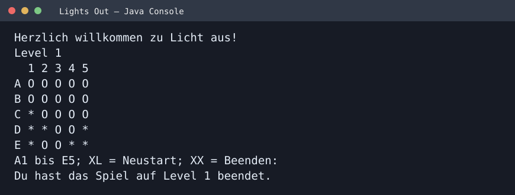

# Lights Out (Java)

A 5×5 console puzzle where selecting a cell toggles that light and its orthogonal neighbours.



## Features
- Coordinates A1–E5 to select a light
- Neighbour toggling and solved-state detection
- Progressive levels, restart (`XL`) and quit (`XX`)
- Java console interface (German)

## Run
Requires JDK 17+.

```bash
mkdir -p out
javac -encoding UTF-8 -d out src/*.java
java -cp out Spiel
```

The screenshot is rendered from the recorded output of a compiled run, also saved in [console-output.txt](screenshots/console-output.txt).

*An independent educational Java console project.*
